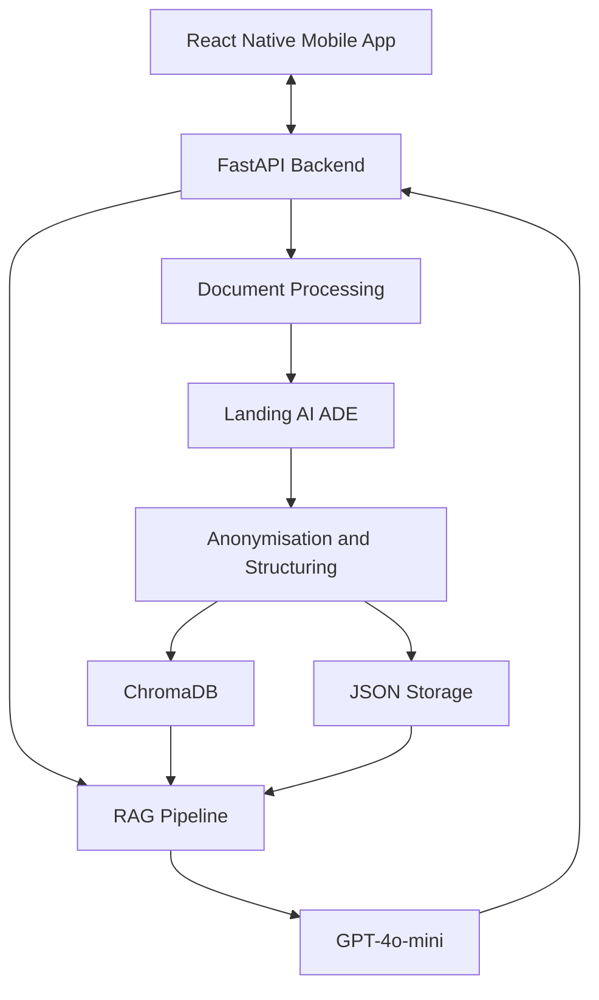

# MediScan AI

### AI-powered assistant for laboratory test results interpretation


## Overview

MediScan AI is an intelligent mobile application designed
to help users understand laboratory test results through
Large Language Models (LLMs) and Retrieval-Augmented
Generation (RAG).

The project was developed as an engineering thesis in
Technical Computer Science at Wrocław University of
Science and Technology.

Its primary objective is to transform complex medical
documents into accessible, structured and understandable
information while supporting users in managing their
laboratory test history.

## Key Features

- AI-powered interpretation of laboratory test results
- Medical document processing from PDFs and images
- Automated data extraction and structuring
- Personal data anonymisation mechanisms
- Retrieval-Augmented Generation (RAG)
- Semantic search using a vector database
- Prioritisation of recent laboratory results
- Multiple patient profiles
- Laboratory test history management
- Conversational AI interface
- Medical safety guardrails

## Technology Stack

| Component | Technology |
|---|---|
| Backend | Python, FastAPI |
| Frontend | React Native, Expo, TypeScript |
| Large Language Model | GPT-4o-mini |
| Document processing | Landing AI ADE |
| Vector database | ChromaDB |
| Data storage | JSON |
| Communication | REST API |
| AI architecture | Retrieval-Augmented Generation |

## System Architecture

The application follows a distributed, multi-layer
architecture, separating presentation, business logic
and data storage.



## AI Processing Pipeline

1. The user uploads laboratory test results.
2. Medical information is extracted from the document.
3. Selected personal identifiers are removed.
4. Extracted information is structured and divided
   into smaller chunks.
5. Text embeddings and metadata are stored in ChromaDB.
6. Relevant information is retrieved based on user queries.
7. The LLM generates a context-aware response using
   retrieved information and medical safety instructions.

## Project Structure

```text
MediScan-AI/
├── beckend/
│   ├── api/
│   ├── processing/
│   ├── repositories/
│   ├── schemas/
│   └── services/
├── mobile-app/
│   ├── assets/
│   └── src/
│       ├── app/
│       ├── hooks/
│       ├── services/
│       └── views/
├── api_server.py
├── requirements.txt
├── .gitignore
└── README.md
```

## Testing and Evaluation

The project was evaluated in several areas:

- Medical document extraction accuracy
- Consistency of extracted laboratory parameters
- Relevance of retrieved information
- AI-generated response accuracy
- Prioritisation of recent test results
- Personal data anonymisation
- Compliance with the intended non-diagnostic scope

The evaluation also identified system limitations,
including the impact of image quality on document
extraction and challenges associated with retrieving
relevant historical information.

## 🚀 Getting Started

### Backend

Install Python dependencies:

```bash
pip install -r requirements.txt
```

Configure the required API credentials locally.
OpenAI and Landing AI API access is required.

Start the backend:

```bash
uvicorn api_server:app --host 0.0.0.0 --port 8000
```

### Mobile Application

```bash
cd mobile-app
npm ci
npx expo start
```

Configure the backend API address in the mobile
application to match your local environment.

## Future Development

- Secure user authentication
- Cloud-based data storage
- Dynamic patient profile management
- Interactive laboratory parameter charts
- Historical result comparison
- Improved data anonymisation mechanisms
- Further evaluation of AI response reliability

## Disclaimer

MediScan AI is an academic research and engineering
project. It is not a certified medical device and does
not provide medical diagnoses or treatment recommendations.

AI-generated information should not replace professional
medical advice.

API credentials and private medical documents are not
intended to be included in this repository.

## Author

**Hanna Selerowicz**

Technical Computer Science — Systems in Medicine

Wrocław University of Science and Technology

Engineering Thesis Project | 2026
